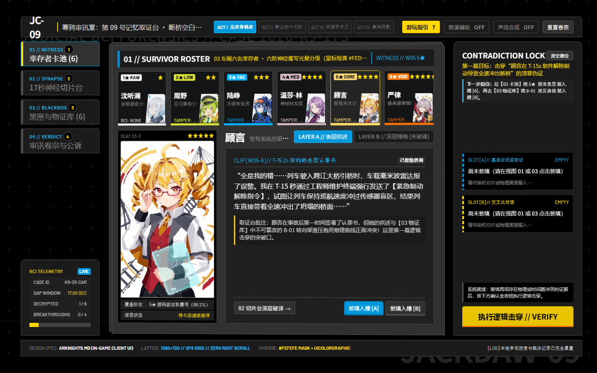
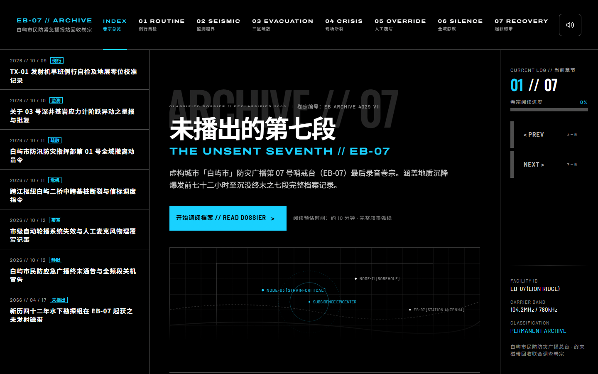

# 讲鹰语.md

> 让您的 agent 交付物充斥鹰角叔叔的香甜舟味

鹰角网络（Hypergryph）旗下游戏界面的 `DESIGN.md` 设计系统分析 —— 一个风格，一份文件。

仓库 slug 是 `hypergryph-design-md`。GitHub 的仓库名只接受 ASCII 字母、数字与 `.-_`，所以「讲鹰语.md」作为中文名展示在标题与仓库简介里，链接地址仍用 slug。

## English summary

**讲鹰语.md** — "Hypergryph-speak". Unofficial `DESIGN.md` design-system analyses for Hypergryph
titles: **Arknights** and **Arknights: Endfield**. Tagline: *let your agent's deliverables brim with
Uncle Hypergryph's sweet Arknights flavour.*

Each file is a complete, self-contained `DESIGN.md` following the format defined by
[VoltAgent/awesome-design-md](https://github.com/VoltAgent/awesome-design-md) — one style, one file,
flat: no index, no registry, no per-style subdirectories, and no cross-references between files.
Copy the one you want into your project root as `DESIGN.md` and let your AI coding agent build UI
against it. These analyses are unofficial and are not affiliated with or endorsed by Hypergryph.

## 这是什么

- **一个风格一份 `.md`**。仓库是平的：没有家族索引、没有注册表、没有检索机制，也没有按风格分的子目录。
- 每一份文件都是**自包含**的设计系统文档，遵循 Google Stitch 的 `DESIGN.md` 格式 —— YAML frontmatter 声明颜色、字体、间距、圆角与组件 token，正文说明这套界面为什么长这样、什么时候该用哪一条，以及如何在脱离原版引擎/脚本时保持真实的**视觉尺度（Optical Scale）与留白疏密张力**。
- 三份文件**互不引用**。你可以单独拿走任意一份，不需要其他文件在场，也不会有任何链接失效。

## 怎么用

1. 把你想用的那一份 `.md` 复制到你项目的根目录，并重命名为 `DESIGN.md`：

   ```bash
   cp arknights-website.md your-project/DESIGN.md
   ```

2. 然后在任意 AI coding agent（Claude Code、Cursor、Antigravity、DeepSeek Harness 等）里说一句：

   > 按项目根目录的 DESIGN.md 做界面

3. 想换风格就换文件，**不要同时放多份** —— 一次只让一份 `DESIGN.md` 生效，否则 agent 会收到互相冲突的指令。
4. 也可以直接把文件内容整段贴进对话或系统提示。它就是纯文本，没有依赖、没有构建步骤、没有外部资源。

## 收录内容

| 文件名 | 风格 | 一句话描述 | 证据来源 |
| --- | --- | --- | --- |
| `arknights.md` | 《明日方舟》**游戏本体** | 1280×720 画布，2px 硬网格 / 5px 控件步进 / 10px 屏幕步进 / 50px 留白；**视觉字号与 Unity 容器盒高解耦**（0.55–0.65× 呼吸比）；面板体 `#313131` 配 `#1B1B1B` 错位背板与 1°–3° 微倾透视；**UI chrome 是白色遮罩 + 运行时染色**（128 张纯平 `#FEFEFE` + 152 个 `UIColorGraphic`）；六阶稀有度光晕 `#FEFEFE`→`#FE7200`（星形恒黄）；七态开关家族无 hover/pressed；上圆下方九宫格签名；三声部字体 Novecento Wide / Bender / Noto Sans S Chinese | 依据客户端**出厂内嵌 UI**（未加密的 Unity 序列化资源）：6,807 GameObject / 6,417 RectTransform / 107 Canvas / 1,231 Texture2D / 20 Font，贴图内存内解码量化（588 张），九宫格边框实测 169 个 Sprite |
| `arknights-website.md` | 《明日方舟》**官网** | 硬工业近黑界面，纯 `#000000` 画布 + 单一电光青 `#18d1ff`，直角、1px 渐变发丝线与 8px 青左规、`#242424` 巨大幽灵字；**60% 暗场留白与微距元数据簇**、三区主题色明度与暗角约束；四声部字体（Novecento Sans Wide / Oswald / Bender / 思源黑体） | 依据 `ak.hypergryph.com` 官方样式表（152,714 字节 CSS）、官方页面截图，并与 PC 客户端共享字体/调色板做独立交叉核验 |
| `endfield-website.md` | 《明日方舟：终末地》**官网** | 信号黄工业科技界面，近黑 `#191919` 与近白 `#ffffff` 双地色 + 单一高压黄 `#fffa00`，圆形/胶囊控件与 4px 卡片、10px 环境阴影、斜纹警示渐层；**附 1920p 画布至标准桌面视口的 `×0.65` 光学尺度归一化表**；`1px` `+` 十字测绘靶标与 `//` 分类前缀赋予白底工程蓝图张力；元素有专属色相、职业只用单色字形 | 依据 `endfield.hypergryph.com` 官方样式表（370,417 字节 / 9 个 CSS）与官方页面截图，元素色取自官方 CDN 的 `ele-*.jpg` 图标量化取样 |

> **命名约定**：`<游戏>.md` = 分析**游戏本体**；`<游戏>-website.md` = 分析**官方网页**。
>
> 两者不是同一套语言，而且差别不在细节。官网是**海报语言**（巨大展示字、满幅美术、单一强调色）；游戏本体是**操作语言**（2px 网格、运行时染色的白模、颜色编码的状态系统）。举例：官网说"只有一个强调色"，而游戏本体有完整的六阶稀有度色阶加语义色——因为前者的克制是营销选择，后者要靠颜色承载信息。

> **关于《终末地》游戏本体**：暂时缺席。它可读的那 10 个 Unity 文件里装的不是出货 UI，而是**调试工具链与 SDK 账号层**——483 个 `sr_` 对象是第三方调试控制台 SRDebugger，219 张贴图里 73 张是 Unity 编辑器插件资源。出货 UI 在 `StreamingAssets\VFS`（42 GB）后面，索引是加密的。所以现在写 `endfield.md` 只会写出一份**调试控制台的设计系统**，那是错的。缺的这份等有可靠证据再补。

## 演示 / Demos

本仓库提供两份完全独立原创世界观、零外部素材依赖的单文件交互演示，分别严格对应 **`arknights.md`（游戏本体操作终端语言）** 与 **`arknights-website.md`（官网海报档案语言）**：

---

### Demo 1（基于 `arknights.md` 游戏本体规范）：《寒鸦审讯室：第 09 号记忆取证台》// JACKDAW-09

[](https://cheeseghostfox.github.io/hypergryph-design-md/demo/arknights-jc09/)

一份**严格照着 `arknights.md`（游戏本体 UI）做出来**的**非滚动锁屏交互式推理解谜终端**：一起离奇的跨江自动驾驶列车断桥坠江案，03 车厢六名幸存者的商用脑机接口在坠桥前 `T-17.0s` 至 `T-00.0s` 出现了高度一致的假记忆与空白；你作为第 09 号记忆取证台操作员，在锁屏战术控制台中通过四幕逻辑击穿揭开惊天共谋。

- **在线预览**：<https://cheeseghostfox.github.io/hypergryph-design-md/demo/arknights-jc09/>
- **源码**：`demo/arknights-jc09/index.html` —— 自包含单文件（内联 6 位幸存少女无描边构成主义几何切面 SVG 立绘），零外部依赖、无构建步骤，双击即玩
- **构建分片**：`demo/arknights-jc09/parts/` —— 完整映射 `arknights.md` 的 40 色令牌、校准后光学字号 + 容器盒高呼吸比、上圆下方 `(N,N,N,0)` 九宫格圆角与错位背板
- **验收输出**：`demo/arknights-jc09/verify-out/` —— 五张实测截图（含四步游玩指引弹窗）及 `audit.json`（`16/16` 端到端交互断言全通过，`FAIL 0`）

| 核心机制（映射自 `arknights.md`） | 交互与叙事说明 |
| --- | --- |
| **1280×720 锁屏非滚动舞台** | 根视口严格 `overflow: hidden` 零滚动条；通过左侧 4 视图战术切页（快捷键 `1`–`4`）与顶部可随时呼出的**四步交互游玩指引弹窗（`?` 键）**承载约 9,500 字高张力悬疑叙事 |
| **六人差异化构成主义矢量立绘** | 6 名幸存少女（盲眼调音师沈听澜、见习乘务周野、战术安全员陆峥、神经科医师温莎·林、智驾总架构师顾言、最高司法督察严律）各自具备独立的姿势、服饰、神态与俄式构成主义几何背景，全部以纯内联 SVG 矢量块面绘制 |
| **六阶光晕卡池 + 恒黄星标** | 6 名幸存者卡片按「神经覆写阶位」应用 `1★ #FEFEFE` → `6★ #FE7200` 六阶底边光晕，而星标在所有阶位恒为 `#FEDC01`（`ArrowLeft`/`Right` 快速切人） |
| **七态开关神经滤波台** | 完整实现 `normal / on / off / select / selected / unselect / unselected` 七态开关矩阵；匹配证人特征码（或一键校准）即可剥离表层伪证、解锁 `LAYER B` 深层残响与动态示波器包络 |
| **白模遮罩 + 运行时染色** | 转向架液压曲线、爆炸螺栓与声学频谱等工程图纸均以 `#FEFEFE` 纯白 SVG 遮罩绘制，通过 CSS `.ui-color-graphic` 在运行时动态赋予语义色 |
| **双槽矛盾指证锁与三向终局** | 右侧常驻 `SLOT [A]` / `SLOT [B]` 交叉比对器，依次击穿四幕伪证锁（含可选「推演辅助线索高亮」与「一键自动装填第一幕示范」），最终在 `#E8C400` 确认金 / `#EC3140` 危险红 / `#0098DC` 品牌蓝三向公诉结局中做出裁决并持久化至 `localStorage` |

---

### Demo 2（基于 `arknights-website.md` 官网规范）：《未播出的第七段》// THE UNSENT SEVENTH

[](https://cheeseghostfox.github.io/hypergryph-design-md/demo/arknights-eb07/)

一份**只照着 `arknights-website.md` 做出来**的示例页面：**《未播出的第七段》// THE UNSENT SEVENTH** —— 虚构城市「白屿市」民防广播站 EB-07 的回收卷宗，七段记录，一个完整叙事弧线。

- **在线预览**：<https://cheeseghostfox.github.io/hypergryph-design-md/demo/arknights-eb07/>
- **源码**：`demo/arknights-eb07/index.html` —— 自包含单文件，约 106 KB，零依赖、无构建步骤，双击就能开
- **构建分片**：`demo/arknights-eb07/parts/` —— 其中 `05-style-tokens.css` 就是把 frontmatter 里的 token 落成 CSS 变量的那一层，可以直接对照着看规范怎么变成代码
- **验收输出**：`demo/arknights-eb07/verify-out/` —— 横竖两版截图与 `audit.json`（`ok: true`、`errors: []`）

**它不是一张静态长图。** 页面里有四项真实交互：

| 能力 | 说明 |
| --- | --- |
| **可展开档案** | 14 处原生 `<details>`：左栏 7 行索引可展开「卷宗摘要」，章节内 7 个「解密附件」块；默认全部收起 |
| **终局抉择** | 章末二选一（重新发射最后一段 / 维持静默封存），两段互斥收尾正文，选择记入 `localStorage` 并可清除重选 |
| **键盘与持久化** | `ArrowLeft` / `ArrowRight` 切章；已读行标记 +「回到上次读到」；阅读进度与音频意图跨会话保留 |
| **磁带扫描** | 点击索引行时一道 0.3–0.5s 的青色扫描读数；`prefers-reduced-motion` 下取消动画并直落稳定态 |

零依赖是认真的：没有框架、没有第三方脚本、没有音频文件——那段环境底噪是 Web Audio 用 50 Hz 正弦加低通白噪声**现场合成**的。

这是一段**演示，不是规范的一部分**：它回答的是「照着 `arknights-website.md` 能长出什么」，而不是「必须这样写」。它只用到了 `arknights-website.md` 这一份文件，没有引用 `endfield-website.md`，也没有用上后来从游戏本体提取的 `arknights.md`。

> **字体说明**：示例页用的是公开替身字体（Archivo / Barlow / Oswald / Noto Sans SC，从 Google Fonts 加载），因为 `arknights-website.md` 里记录的原版字体 Novecento Sans Wide 与 Bender 并不公开分发 —— 这正是该文件「Note on Font Substitutes」一节建议的做法。

**Demo (English).** A sample page built strictly from `arknights-website.md` — *THE UNSENT SEVENTH*, a seven-chapter fictional archive of a civil-defence broadcast station. Self-contained single HTML file (~106 KB), no build step, no dependencies beyond web fonts. **It is not a static page**: it ships 14 native `<details>` dossiers, a two-way ending choice persisted to `localStorage`, arrow-key chapter navigation with cross-session reading progress, and a tape-scan animation that honours `prefers-reduced-motion`. Even the ambient hum is synthesised live with Web Audio rather than loaded from a file. It demonstrates the specification; it is not part of it.

## 更新说明 / Release Notes

完整的历史变更记录见 [CHANGELOG.md](CHANGELOG.md)。

### 2026-10-22 · 审美与视觉工程校准（Aesthetic & Optical Scale Calibration）

针对三份 `DESIGN.md` 规范进行了系统性的**视觉尺度解耦、空间疏密语法补全与 Token 自洽性校准**（全部通过 `@google/design.md` 校验，`0 errors`、`0 orphaned-tokens`）：

1. **视觉尺度与物理容器尺度解耦（Optical vs. Physical Scale Decoupling）**
   - **`arknights.md`（游戏本体）**：将 YAML `typography` 从 Unity `RectTransform` 的物理外框高度校准为真实**视觉字号（Optical Glyph Size）**（如 `display: 72px` / 盒高 `100px`、`headline: 32px` / 盒高 `50px`、`card-title: 24px` / 盒高 `40px`、`row-title: 18px` / 盒高 `30px`、`body: 16px` / 盒高 `25px`、`label: 13px` / 盒高 `20px`、`caption: 11px` / 盒高 `16px`），并在 `Typography -> Hierarchy` 中提供双列对照表，明确鹰角客户端**字号约为容器高度 `0.55–0.65×`、上下预留 `35%–45%` 呼吸暗空间**的排版核心。
   - **`endfield-website.md`（终末地官网）**：新增 **视口光学尺度归一化表（`×0.65` Standard Desktop Factor）**。因原站通过脚本将 `1080×1920` 画布动态缩放至当前视口（常规桌面端根字号约 `10.4px–12px`），若在标准 `1rem = 16px` 静态网页中按 1:1 像素硬套会导致控件肥大失真；现明确给出标准桌面端光学尺寸（`button-primary`: `100px → 64px`、`button-secondary`: `67px → 48px`、`subpage-tab`: `168px → 108px`、`subpage-header`: `506px → 320px`，并区分 `100px` 全屏转场加载带与 `8px–12px` 行内进度条）。

2. **空间构成与微图形语法补全（Compositional & Micro-Graphic Grammar）**
   - **留白虚空 vs. 零松弛遥测簇（Void-to-Cluster Contrast）**：在三份规范中量化了鹰角 UI 的疏密反差法则——全局保持 `45%–60%+` 的开放底色/立绘呼吸场（使 `#242424` / `#d9d9d9` 幽灵巨字与结构色条成为真正的建筑骨骼），而局部信息单元采用 `0px–4px` 的高密度集群排布，杜绝平均主义的“等距卡片网格”。
   - **错位背板与微倾透视（`arknights.md`）**：补全了无阴影体系下的厚度语言——主面板（`#1B1B1B`）右下方错位 `4px–8px` 叠放浅灰背板（`#313131`）或 `1px` 线框，以及主界面面板群在相机空间的 `1°–3°` 微倾透视。
   - **工业测绘靶标与蓝图微图形（`endfield-website.md`）**：在 `Shapes -> Decorative Geometry` 中将网格交点处的 `1px` `+` 十字准星（Fiducial Crosshairs）、`//` 双斜杠分类前缀（`// OPERATORS`）以及非混合模式的平面点阵/波形底板（`points-bg`、`tape-wave-bg`）确立为必选几何特征，防止纯白底色退化为普通电商网格。

3. **YAML 与正文审美自洽性修复（Self-Consistency & Luminance Discipline）**
   - **`arknights-website.md`（明日方舟官网）**：修复 `news-card` 的 `typography` 为 `{typography.card-title}`（32px 展示级标题），消除“YAML 写正文小字、正文严禁青底放小字”的自相矛盾；将 `filter-tab-active/default` 校准为 `height: 24px` 与 `{typography.body-sm}`（12px）；为高明度暖灰褐底色 `region-surface-taupe`（`#898175`）补充暗角渐晕（`rgba(0,0,0,0.45–0.65)`）约束；同步客户端四声部字体的实测结论。
   - **纯净几何组件清洗**：剥离了三份规范中纯几何分割线、进度条轨道与色带组件上冗余的 `typography` 与 `textColor` 伪属性。

## TODO / 下一步

**目标：克制地逆向工程两个游戏本体。**

《明日方舟》**已完成**，产出就是本仓库的 `arknights.md`。《终末地》受阻——可读集合里只有调试工具层，详见下方现状说明。执行时遵守的边界如下：

- [ ] **只要原版 UI** —— 分析对象限定为**客户端出厂内嵌的 UI**（未加密的 `sharedassets*` / `resources.assets` / `globalgamemanagers`）；**不去解热更资源包**。后者装的是活动、皮肤、联动等增量内容，美术方向彼此不一致，混进一份设计系统只会稀释它——出厂内嵌 UI 才是这套系统在「没有活动、没有皮肤」时的样子
- [ ] **不提取任何业务实现** —— 不注入、不 hook、不 dump 进程内存、不触碰反作弊；静态分析客户端二进制以理解其资源封装方式是允许的，但结论只用于理解资源，不用于复制实现
- [ ] **不抄袭美术资源** —— 不导出、不转载、不重制任何立绘、图标、字体或音频文件；读取与量测只在内存中进行，**本仓库永远只出现设计模式文本，不出现游戏素材**
- [ ] **只提取设计模式** —— 只归纳可复用的设计决策：色彩角色与语义、字阶与字距、间距节奏、形状语法、状态编码规则、动效时长与缓动
- [ ] 产出仍然只是 `DESIGN.md`：写**规则与理由**，不是资产的复制品
- [ ] 每条结论标注证据来源与可靠度，取不到的部分在 `Known Gaps` 里如实留白

一句话：**要的是「怎么想」，不是「长什么样」。**

> 现状说明：**《明日方舟》已完成**（`arknights.md`），依据是客户端**出厂内嵌的 UI**——读取 6,807 个 GameObject、6,417 个 RectTransform、107 个 Canvas、1,231 张贴图与 20 个字体对象；贴图只在内存中解码量测，磁盘上没有落任何素材。
>
> **《终末地》暂时做不到**，原因与加密无关：它可读的 10 个 Unity 文件里装的是**调试工具链和 SDK 账号层**，不是出货 UI。483 个 `sr_` 对象来自第三方调试控制台 SRDebugger；219 张可解码贴图里 73 张是 Unity 编辑器插件资源，那套"调色板"其实是 Unity 编辑器界面色。出货 UI 在 `StreamingAssets\VFS`（42 GB）里、索引加密。写一份基于调试控制台的 `endfield.md` 是错的，所以不写。
>
> 至于热更资源包（`StreamingAssets\AB\Windows\*.ab`，14,238 个，`flags=0x243` 带 asset-bundle-encryption 位）：**我们不去解它**。理由不是打不开，而是**里面的东西不该进来**——活动、皮肤、联动各有各的美术方向，凑在一起不成体系。设计系统应当描述「出厂状态」，而不是「所有历史内容的并集」。

## 友情链接 / Credits

- 格式与撰写规范来自 **[VoltAgent/awesome-design-md](https://github.com/VoltAgent/awesome-design-md)**。本仓库沿用该项目定义的 `DESIGN.md` 格式与撰写规范。
- 上游那 84 份网站设计文件**没有**被复制到这里，请直接去上游获取。
- 本仓库只收录上游没有的、自行分析撰写的内容。
- 因为这些就是普通的 `DESIGN.md` 文件，所以可以直接放进上游项目的同一套 skill / 工具链里使用。

## 免责声明

- 本仓库是**非官方**的个人分析，与鹰角网络（Hypergryph）**无任何隶属或背书关系**。
- 所有游戏名称、商标与美术资源归各自权利人所有。
- 仓库内**不包含任何受版权保护的素材**：只有对公开可见的 CSS 取值、公开发布的图标与渲染页面所作的分析，以及取样得到的颜色值。
- 这些分析是对证据的一种读法，不是官方文档，也不代表官方设计规范。

## 许可 / Licence

本项目采用 **MIT** 许可，详见 [LICENSE](LICENSE)。

`Copyright (c) 2026 CheeseGhostfox`

`DESIGN.md` 格式本身来源于上方友情链接的 [VoltAgent/awesome-design-md](https://github.com/VoltAgent/awesome-design-md) 项目。
